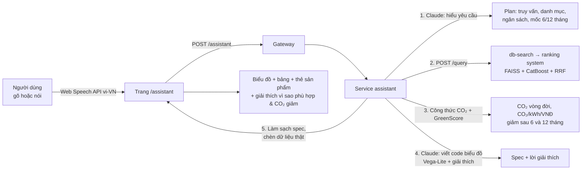

# Smart Product Finder — Trả lời 4 yêu cầu của giáo viên hướng dẫn

> Nhánh: `new-research` (tách từ `origin/paper`, ngày 2026-09-29)
> Phạm vi: rà soát toàn bộ các nhánh, phân tích hiện trạng, đề xuất giải pháp và code đi kèm cho từng yêu cầu.
> Ràng buộc khi làm: **không khởi chạy container / service nào**. Mọi số liệu dưới đây lấy từ đọc code, đọc file backup DB ở chế độ offline, và chạy unit test thuần Python.

## Tóm tắt

| # | Yêu cầu | Hiện trạng (trước nhánh này) | Đã làm trên `new-research` | Còn phải làm |
|---|---|---|---|---|
| 1 | Tập trung một nhóm sản phẩm, ưu tiên sản phẩm xanh | DB gần như chỉ có đồ công nghệ, 74,5 % dòng trùng lặp, 42,5 % giá = 0, không có khái niệm "sản phẩm xanh" | Chọn nhóm **Điện gia dụng tiết kiệm năng lượng** (có cấu hình để quay về đồ công nghệ); bộ trích thông số tiếng Việt; **GreenScore** có giải thích; script kiểm tra DB offline | Cào lại dữ liệu điện gia dụng + thông số, dọn trùng lặp, nối bộ lọc xanh vào ETL |
| 2 | Định nghĩa công thức CO₂ (điểm mới) | LLM 0.8B đoán một con số; không tốt hơn baseline (MAE 77,2 kg vs 68,0 kg) | **Công thức vòng đời tham số hoá** + công thức **CO₂ giảm thải sau T tháng** + khoảng bất định; 16 unit test | Hiệu chỉnh tham số bằng nhãn năng lượng / EPD; chạy thí nghiệm kiểm định |
| 3 | Dùng AI trả phí để đánh giá, số liệu thí nghiệm tốt hơn | Nhãn do Gemini miễn phí gán, "95 %" bị rò rỉ dữ liệu, thực tế ~50 % | Bộ đánh giá dùng **Claude (Anthropic API)** làm giám khảo, NDCG/MAP/MRR + CI bootstrap + kiểm định ý nghĩa, huấn luyện lại CatBoost theo GroupKFold, tự xuất bảng LaTeX và biểu đồ | Cần `ANTHROPIC_API_KEY` và chạy (chi phí ước tính 10–25 USD) |
| 4 | Thiết kế lại web: nhập giọng nói/gõ → phân tích → AI vẽ biểu đồ → giải thích + CO₂ giảm 6 tháng/1 năm | Chỉ có ô tìm kiếm văn bản/ảnh, giải thích 3–7 chữ từ LLM 0.8B | Service `assistant` mới + trang `/assistant` (giọng nói, biểu đồ Vega-Lite do AI viết, bảng so sánh, giải thích) + endpoint gateway | Thêm service vào `docker-compose` (cần bạn xác nhận), build & test frontend |

---

## 0. Rà soát các nhánh

Chỉ có 4 nhánh chứa commit mà `develop` chưa có; mọi nhánh khác đã được merge vào `develop` (chỉ "behind").

| Nhánh | Hơn `develop` | Nội dung | Quan hệ |
|---|---|---|---|
| `paper` | 17 commit | `research_paper.tex`, hình, tài liệu tham khảo + toàn bộ `Explanation` | **Mới nhất, chứa tất cả** → dùng làm gốc cho `new-research` |
| `Explanation` | 11 commit | CO₂ bằng LLM local (Qwen 3.5 0.8B qua Ollama), giải thích xếp hạng, UI hiển thị CO₂ | Đã nằm trong `paper` |
| `feature/LocalLLM` | 5 commit | Prompt 2 giai đoạn cho CO₂ | Đã nằm trong `Explanation` |
| `feature/lazada_crawler` | 4 commit | Cào Lazada bằng Scrapling — **vẫn bị chặn anti-bot** | Nhánh cụt, không dùng |
| `develop` / `main` | – | `main` chậm 143 commit so với `develop` | – |

Kết luận: bản code đầy đủ nhất là `origin/paper`; nhánh `new-research` được tạo từ đó.

---

## 1. Yêu cầu 1 — Database: tập trung một nhóm sản phẩm, ưu tiên sản phẩm xanh

### 1.1 Hiện trạng database (đọc offline `backups/pre_category_migration.dump`)

Chạy: `python scripts/research/audit_db_dump.py backups/pre_category_migration.dump`

| Chỉ số | Giá trị | Nhận xét |
|---|---|---|
| Số dòng `product` | 55.409 | |
| URL sản phẩm duy nhất | 14.130 | **74,5 % là dòng trùng** (code cũ chèn mới mỗi lần cào; code hiện tại đã upsert theo `product_url`, nhưng dữ liệu cũ chưa dọn) |
| `final_price = 0` | 23.548 (42,5 %) | Hết hàng / ngừng bán — bị loại khi xếp hạng nhưng vẫn nằm trong FAISS |
| Mô tả rỗng | 43.726 (78,9 %) | Embedding chỉ dựa vào tên → giải thích vì sao tìm "iPhone 16" ra Samsung |
| Hàng cũ / đã qua sử dụng | 18.375 (33 %) | Có thể coi là "xanh" (tái sử dụng) với đồ công nghệ |
| Có dấu hiệu xanh (Inverter, nhãn năng lượng, Energy Star, tái chế...) | 62 | Gần như **không có** sản phẩm xanh xác định được |
| Theo danh mục | laptop 35.966 · tai nghe 7.962 · màn hình 6.592 · điện thoại 4.689 · đồng hồ 131 · tablet 53 | 100 % đồ công nghệ, lệch nặng về laptop |
| Theo cửa hàng | CellphoneS 44.848 · Phong Vũ 7.664 · Điện Máy Xanh 2.211 · FPT 686 | TGDĐ không có dữ liệu trong bản backup |
| Bảng `image` | 789 dòng | Hầu hết sản phẩm **không có ảnh** → tìm kiếm bằng ảnh gần như vô dụng |

Lưu ý: bản backup là trước migration danh mục. Trên `develop`, spider Điện Máy Xanh (`airflow/scrapers/scrapers/sites/dienmayxanh/listing.py`) **đã có** các danh mục điện gia dụng (Tivi, Máy lạnh, Tủ lạnh, Máy giặt, Nồi cơm, Quạt, Máy lọc không khí, Robot hút bụi), nên chuyển nhóm không phải viết scraper mới.

### 1.2 Chọn nhóm sản phẩm

| Tiêu chí | **A. Điện gia dụng tiết kiệm năng lượng** (khuyến nghị) | B. Sản phẩm công nghệ (hiện tại) |
|---|---|---|
| "Xanh" có tiêu chí khách quan? | Có: **nhãn năng lượng Việt Nam 1–5 sao** (bắt buộc), Inverter, kWh/năm in trên nhãn | Yếu: chỉ có hàng cũ, EPEAT/Energy Star (hiếm khi ghi trên trang bán) |
| CO₂ giảm sau 6 tháng/1 năm (yêu cầu 4) | Lớn và đo được: điều hoà Inverter 5 sao giảm ~478 kg/năm | Gần 0 (điện thoại ~4 kWh/năm) |
| Dữ liệu sẵn có | Phải cào lại (spider DMX/TGDĐ đã hỗ trợ) | 14.130 sản phẩm, seed CO₂ 121 dòng, mô hình CatBoost |
| Tính mới cho bài báo | Cao — ít nghiên cứu gợi ý sản phẩm gắn với tiết kiệm điện ở Việt Nam | Thấp |

**Khuyến nghị: chọn A.** Nó khớp cả 4 yêu cầu: nhóm duy nhất (1), công thức CO₂ có pha sử dụng chiếm ưu thế (2), số liệu thí nghiệm rõ ràng (3), và câu chuyện "dùng 6 tháng / 1 năm giảm được bao nhiêu CO₂" có ý nghĩa (4). Phương án B vẫn giữ trong code (`FOCUS_GROUP=electronics`) để không mất dữ liệu cũ.

### 1.3 Định nghĩa "sản phẩm xanh" — GreenScore

Code: [`green/green_score.py`](../../backend/services/etl-worker/green/green_score.py). Điểm 0–100, dựa trên luật, mỗi điểm đều có lý do hiển thị cho người dùng:

$$
GreenScore = w_1\cdot\text{efficiency} + w_2\cdot\text{label} + w_3\cdot\text{technology} + w_4\cdot\text{certification} + w_5\cdot\text{circularity}
$$

| Thành phần | Cách tính | Trọng số (gia dụng / công nghệ) |
|---|---|---|
| efficiency | $1 - AEC_p / AEC_{chuẩn}$ (từ công thức CO₂) | 40 / 20 |
| label | số sao nhãn năng lượng / 5 | 25 / 0 |
| technology | Inverter / động cơ DC | 15 / 0 |
| certification | Energy Star, EPEAT, TCO, Nhãn Xanh Việt Nam, EU Ecolabel | 10 / 35 |
| circularity | hàng cũ / tân trang | 10 / 45 |

Sản phẩm là **xanh** khi GreenScore ≥ 60 (gia dụng) / 50 (công nghệ), hoặc có nhãn 5 sao. Ví dụ: điều hoà 1 HP Inverter 5 sao = 62,3 → xanh; tủ lạnh 300 L thường = 0 → không xanh.

Thông số được trích từ tên/mô tả tiếng Việt bằng [`green/spec_parser.py`](../../backend/services/etl-worker/green/spec_parser.py): số sao, kWh/năm, kWh/ngày, công suất W/kW, Inverter/DC, CSPF, HP/BTU, lít, kg, inch, khối lượng, chứng nhận, hàng cũ.

### 1.4 Việc cần làm để hoàn tất yêu cầu 1

1. **Dọn trùng lặp** (chạy trên DB khi được phép; nên backup trước):
   ```sql
   DELETE FROM product p USING product q
   WHERE p.product_url = q.product_url AND p.platform_id = q.platform_id AND p.id < q.id;
   CREATE UNIQUE INDEX IF NOT EXISTS ux_product_url_platform ON product (product_url, platform_id);
   ```
   Sau đó **build lại FAISS index** vì id cũ vẫn nằm trong index.
2. **Scraper**: với phương án A, giới hạn `CATEGORIES` của DMX/TGDĐ vào nhóm gia dụng và cào thêm bảng "Thông số kỹ thuật" (nhãn năng lượng, điện năng tiêu thụ, công suất) vào `description`. Đây là file lá (spider riêng), sửa được ngay khi bạn đồng ý.
3. **ETL**: trong `data/process/data_processing.py` (file lõi — **chưa sửa, chờ bạn xác nhận**) thêm:
   ```python
   from green import FOCUS_GROUP, assess_green, is_in_focus, parse_specs
   slug = parsed_data["category"].slug
   if not is_in_focus(slug):
       return                      # bỏ sản phẩm ngoài nhóm
   specs = parse_specs(parsed_data["product"].name, parsed_data["product"].description)
   green = assess_green(slug, specs)
   if os.environ.get("GREEN_ONLY") == "1" and not green.is_green:
       return                      # chế độ "chỉ sản phẩm xanh"
   ```
   và thêm cột `green_score`, `is_green` vào bảng `product` (migration SQL như `backups/migration.sql`).
4. Loại sản phẩm `final_price = 0` khỏi FAISS thay vì chỉ lọc lúc xếp hạng.

---

## 2. Yêu cầu 2 — Công thức CO₂

Chi tiết toán, tham số, ví dụ và kế hoạch kiểm định: **[co2-formula.md](co2-formula.md)**.

### 2.1 Công thức (tóm tắt)

$$
CO_2^{life} = E_{emb} + L\,(AEC\cdot EF_{grid} + R_{leak}) + E_{eol}
$$

$$
\Delta CO_2(T) = \tfrac{T}{12}(AEC_b-AEC_p)\,EF_{grid} + \tfrac{T/12}{L}(E_{emb,b}-E_{emb,p}) + \tfrac{T}{12}(R_{leak,b}-R_{leak,p})
$$

- $AEC$ ưu tiên lấy từ **nhãn năng lượng**, sau đó công suất × giờ dùng, cuối cùng là mặc định danh mục.
- $EF_{grid}$ = hệ số phát thải lưới điện Việt Nam (mặc định 0,6592 kg/kWh — cần xác minh công bố mới nhất).
- Baseline $b$ = sản phẩm tiêu chuẩn **cùng công suất** (cùng HP/lít/kg/inch) → so sánh công bằng.
- Có khoảng bất định theo nguồn dữ liệu (±10 % nhãn, ±25 % công suất, ±40 % mặc định).

### 2.2 Điểm mới so với bài báo hiện tại và các công trình liên quan

- Vestrum et al. và Spillo et al. (đã trích trong `research_paper.tex`) dùng LLM ước lượng **một con số tổng**; ở đây tách **pha sử dụng theo thời gian** và **so sánh với sản phẩm cùng công suất**, trả lời trực tiếp "dùng 6 tháng / 1 năm giảm bao nhiêu".
- Dùng dữ liệu đặc thù Việt Nam: hệ số lưới điện VN, nhãn năng lượng TCVN, giá điện EVN.
- Minh bạch, tái lập được, có kiểm thử; LLM chỉ còn là nguồn phụ cho $E_{emb}$ khi thiếu EPD.

### 2.3 Đã làm

- [`green/co2_formula.py`](../../backend/services/etl-worker/green/co2_formula.py): `estimate_co2()` (vòng đời + theo từng mốc T), `estimate_savings()` (kWh, kg CO₂, tiền điện, quy đổi cây xanh).
- [`tests/test_green.py`](../../backend/services/etl-worker/tests/test_green.py): 16 test (tuyến tính theo thời gian, phân rã vòng đời, Inverter tiết kiệm, hàng chuẩn tiết kiệm 0, hàng cũ giảm phát thải sản xuất, GreenScore...) — **16/16 pass**.

### 2.4 Tích hợp (chưa làm — chạm file lõi)

Trong `carbon_estimator.estimate_product_co2e`: nếu danh mục có trong `CATEGORY_PARAMS` thì dùng `estimate_co2()` làm giá trị chính (`co2e_source = "formula"`), dùng LLM/seed chỉ để cung cấp `embodied_override`. Lưu thêm `co2e_saved_6m_kg`, `co2e_saved_12m_kg`, `annual_kwh` vào bảng `product`.

---

## 3. Yêu cầu 3 — Dùng AI trả phí để đánh giá, số liệu thí nghiệm tốt hơn

### 3.1 Vì sao độ chính xác thực tế ~50 % trong khi bài báo ghi 95 %

Rà soát `dataset_creator.py`, `test-CatBoostRankerMQ2008.ipynb` và `research_paper.tex`:

1. **Rò rỉ dữ liệu**: dữ liệu được "tăng cường" bằng cách nhân bản nhóm truy vấn rồi mới `GroupShuffleSplit` → bản sao của cùng một truy vấn có thể nằm ở cả train và test.
2. **Âm tính tổng hợp quá dễ**: 4/12 dòng mỗi truy vấn là "garbage" sinh ngẫu nhiên (`generate_garbage_mock_features`) với nhãn 0 → mô hình chỉ cần phân biệt dữ liệu giả, nâng điểm một cách giả tạo.
3. **Nhãn không được kiểm chứng**: nhãn 0–3 do Gemini miễn phí gán với ~30 ví dụ, không đo độ đồng thuận với người.
4. **Sai chỉ số**: "accuracy" trên thang 0–3 không phải chỉ số xếp hạng; cần NDCG@k, MAP, MRR.
5. **Tập nhỏ**: 40 truy vấn, không có khoảng tin cậy, không kiểm định ý nghĩa thống kê.
6. **CO₂**: validation LOO chỉ 30 sản phẩm thuộc 5 danh mục có sẵn trong seed; LLM thua baseline trung bình láng giềng.
7. **Giải thích xếp hạng**: gọi Qwen 0.8B với timeout 10 giây → phần lớn rơi về heuristic.

### 3.2 Giải pháp: Claude làm giám khảo + quy trình đánh giá chuẩn IR

Code trong [`backend/services/ranking_system/evaluation/`](../../backend/services/ranking_system/evaluation/):

| File | Vai trò |
|---|---|
| `llm_judge.py` | Gọi **Claude Opus 5.5** (Anthropic API, trả phí) chấm liên quan 0–3 kèm lý do; structured output JSON; cache kết quả vào JSONL (chạy lại không tốn tiền); prompt caching cho system prompt; bật **server-side fallback** khi model từ chối |
| `export_candidates.py` | Chạy trong container ranking: với mỗi truy vấn lấy top-50 FAISS, 7 feature, và thứ hạng của 3 hệ thống (FAISS, CatBoost, CatBoost + RRF CO₂) |
| `run_eval.py` | Chấm nhãn, tính NDCG@5/10/20, P@k, MAP, MRR với **CI 95 % bootstrap** và **kiểm định hoán vị cặp** (p-value); so khớp với nhãn người (Cohen's κ bậc hai, accuracy, ±1); xuất `results.json`, `results_table.tex`, `fig_ndcg.png`, `fig_agreement.png` |
| `train_ranker.py` | Huấn luyện lại CatBoost trên nhãn Claude, **chỉ dữ liệu thật** (không có dòng giả), **GroupKFold theo truy vấn** (không rò rỉ), báo cáo NDCG@10 từng fold |
| `metrics.py` | Cài đặt chỉ số (đã kiểm tra thủ công bằng ví dụ) |
| `eval_queries.txt` | 40 truy vấn tiếng Việt cho nhóm điện gia dụng (khác `query_list.txt` dùng để huấn luyện) |
| `human_labels.template.csv` | Mẫu để nhóm tự gán nhãn ~200 cặp, dùng kiểm chứng giám khảo |

### 3.3 Thiết kế thí nghiệm cho phần "Experiments" của bài báo

| Thí nghiệm | Đầu ra (bảng/biểu đồ) |
|---|---|
| E1. Độ tin cậy của giám khảo LLM: Claude vs người trên ~200 cặp | κ bậc hai, accuracy, ma trận nhầm lẫn (`fig_agreement.png`) |
| E2. Chất lượng xếp hạng: FAISS vs CatBoost vs CatBoost + RRF | Bảng NDCG@5/10, MAP, MRR, P@10 kèm CI 95 % (`results_table.tex`), biểu đồ cột (`fig_ndcg.png`) |
| E3. Huấn luyện lại CatBoost bằng nhãn Claude, GroupKFold 5 fold | NDCG@10 trung bình ± độ lệch chuẩn (`train_cv.json`) — thay cho con số "95 %" |
| E4. Đánh đổi liên quan – CO₂ khi thay trọng số RRF $w_c$ ∈ {0; 0,1; 0,2; 0,5; 1} | Đường cong NDCG@10 vs CO₂ trung bình top-10 (giống Vestrum et al.) |
| E5. Công thức CO₂ vs LLM 0.8B vs LLM trả phí vs trung bình láng giềng | MAE, MAPE, Spearman ρ trên sản phẩm có EPD/nhãn (xem co2-formula.md mục 6) |
| E6. Phân tích độ nhạy công thức CO₂ | Biểu đồ tornado |

### 3.4 Cách chạy (khi được phép chạy service)

```bash
# 1) trong container ranking-system (cần FAISS + Postgres)
python -m evaluation.export_candidates --queries evaluation/eval_queries.txt --out evaluation/out/candidates.jsonl
# 2) ở bất kỳ máy nào có API key
pip install -r evaluation/requirements-eval.txt
export ANTHROPIC_API_KEY=...          # KHÔNG commit key vào backend/.env.dev
python -m evaluation.run_eval --candidates evaluation/out/candidates.jsonl --human evaluation/human_labels.csv
python -m evaluation.train_ranker --save models/catboost_ranker_model.txt
```

**Chi phí ước tính**: 40 truy vấn × 50 ứng viên = 2.000 lượt chấm, mỗi lượt ~700 token vào (phần system được cache) + vài trăm token ra → khoảng **10–25 USD** với Claude Opus 5.5 ($4 / $20 mỗi triệu token). Có thể giảm ~50 % bằng Message Batches API nếu không cần kết quả ngay. Cấu hình model qua `JUDGE_MODEL`, mức suy nghĩ qua `JUDGE_EFFORT`.

---

## 4. Yêu cầu 4 — Thiết kế lại website

### 4.1 Luồng xử lý



### 4.2 Các thành phần đã viết

| File | Vai trò |
|---|---|
| [`backend/services/assistant/main.py`](../../backend/services/assistant/main.py) | FastAPI `POST /assistant {message, lang}` — điều phối 5 bước trên, lọc theo ngân sách, đưa sản phẩm xanh lên đầu danh sách rút gọn |
| [`assistant/assistant_llm.py`](../../backend/services/assistant/assistant_llm.py) | 2 lời gọi Claude có structured output: (1) lập kế hoạch từ câu nói (chịu được lỗi nhận dạng giọng nói), (2) viết 1–2 spec **Vega-Lite** + bảng + giải thích + lý do từng sản phẩm, **chỉ được trích số từ bảng hệ thống tính** |
| [`assistant/chart_sanitizer.py`](../../backend/services/assistant/chart_sanitizer.py) | "AI tự sinh code vẽ biểu đồ" nhưng an toàn: xoá `url`, `href`, dữ liệu lồng, chặn chuỗi `http:`/`javascript:`; từ chối spec dùng cột không tồn tại; chèn dữ liệu thật vào spec |
| [`assistant/Dockerfile`](../../backend/services/assistant/Dockerfile) | Build context `backend/services` để dùng chung gói `green` |
| [`gateway/main.py`](../../backend/services/gateway/main.py) | Thêm `POST /assistant` (trả 503 nếu chưa cấu hình `ASSISTANT_URL`, không ảnh hưởng phần còn lại) |
| [`frontend/src/pages/Assistant.jsx`](../../frontend/src/pages/Assistant.jsx) | Trang mới: ô nhập + nút micro, hiển thị giải thích, biểu đồ, bảng, thẻ sản phẩm có huy hiệu "Sản phẩm xanh" và "Giảm X kg CO₂ sau 6 tháng · Y kg sau 1 năm" |
| `components/assistant/VoiceInput.jsx` | Nhận giọng nói tiếng Việt/Anh bằng Web Speech API (tự ẩn nếu trình duyệt không hỗ trợ, ví dụ Firefox) |
| `components/assistant/ChartView.jsx` | Render spec bằng vega-embed tải từ CDN khi cần (không thêm dependency npm) |
| `App.jsx`, `Header.jsx`, `Home.jsx`, `i18n/vi.json`, `i18n/en.json` | Route `/assistant`, liên kết trên header và trang chủ, chuỗi song ngữ |

Vì sao sinh **Vega-Lite** thay vì để AI viết JavaScript tuỳ ý: Vega-Lite là mã khai báo, không thực thi lệnh, nên AI vẫn "tự viết code biểu đồ" nhưng không thể chèn mã độc hay tự bịa dữ liệu; số liệu luôn do hệ thống tính.

### 4.3 Việc còn lại

1. Thêm service vào `docker-compose.dev.yml` (**chưa sửa — file hạ tầng dùng chung, chờ bạn xác nhận**):
   ```yaml
   assistant:
     build:
       context: ./backend/services
       dockerfile: assistant/Dockerfile
     container_name: smartproductfinder-assistant
     ports:
       - "8070:8070"
     env_file:
       - ./backend/.env.dev
     environment:
       - ANTHROPIC_API_KEY=${ANTHROPIC_API_KEY}   # lấy từ môi trường, không ghi vào file
     depends_on:
       - db-search
   ```
   và thêm `ASSISTANT_URL="http://smartproductfinder-assistant:8070"` vào `backend/.env.dev`.
2. Build và kiểm tra frontend (máy hiện tại không có Node.js nên chưa build được JSX).
3. Tuỳ chọn: nhận dạng giọng nói phía server (cho trình duyệt không có Web Speech API).
4. Khi đã nối công thức CO₂ vào ETL (mục 2.4), `assistant` có thể đọc `annual_kwh` từ DB thay vì chỉ trích từ tên sản phẩm.

---

## 5. Gợi ý cập nhật `research_paper.tex`

- **Contributions**: thay mục 4 ("two-stage local LLM") bằng "công thức CO₂ vòng đời tham số hoá, tách pha sử dụng theo thời gian, cho biết lượng CO₂ giảm thải sau T tháng so với sản phẩm cùng công suất"; thêm "trợ lý đa phương thức (giọng nói/văn bản) sinh biểu đồ".
- **Methodology**: thêm mục công thức (mục 3 của co2-formula.md), GreenScore, và quy trình giám khảo LLM.
- **Evaluation**: thay "95 % accuracy" bằng E1–E6 ở mục 3.3; báo cáo NDCG/MAP có CI.
- **Limitations**: nêu rõ tham số mặc định là giả định cho đến khi hiệu chỉnh bằng nhãn năng lượng/EPD.

## 6. Danh sách thay đổi trên nhánh `new-research`

Mới:
- `docs/research/advisor-requirements.md`, `docs/research/co2-formula.md`
- `backend/services/etl-worker/green/` (`__init__.py`, `focus.py`, `spec_parser.py`, `co2_formula.py`, `green_score.py`) + `tests/test_green.py`
- `backend/services/ranking_system/evaluation/` (`llm_judge.py`, `metrics.py`, `export_candidates.py`, `run_eval.py`, `train_ranker.py`, `eval_queries.txt`, `human_labels.template.csv`, `requirements-eval.txt`)
- `backend/services/assistant/` (`main.py`, `assistant_llm.py`, `chart_sanitizer.py`, `requirements.txt`, `Dockerfile`)
- `frontend/src/pages/Assistant.jsx`, `frontend/src/pages/components/assistant/{VoiceInput,ChartView}.jsx`
- `scripts/research/audit_db_dump.py`

Sửa (file lá): `backend/services/gateway/main.py`, `gateway/dto/gateway_dto.py`, `frontend/src/App.jsx`, `Home.jsx`, `Header.jsx`, `i18n/vi.json`, `i18n/en.json`, `ranking_system/.gitignore` (bỏ qua `evaluation/out/`), `docs/co2-setup.md` (thêm liên kết tới tài liệu mới).

**Chưa sửa (file lõi, chờ xác nhận)**: `etl-worker/data/process/data_processing.py`, `carbon_estimator.py`, `docker-compose.dev.yml`, `backend/.env.dev`, cấu hình danh mục của spider.

## 7. Đã kiểm tra / chưa kiểm tra

- ✅ `pytest tests/test_green.py` — 16/16 pass (Python 3.12, môi trường ảo tạm).
- ✅ `scripts/research/audit_db_dump.py` chạy trên file backup thật, ra đúng các số ở mục 1.1.
- ✅ Chỉ số trong `metrics.py` kiểm tra bằng ví dụ tính tay; mọi file Python mới đều `py_compile` được; `chart_sanitizer` kiểm tra với spec hợp lệ / cột giả / JSON hỏng.
- ⚠️ Chưa chạy: service `assistant`, gateway, frontend (không có Node.js, và theo yêu cầu không khởi chạy service), các lời gọi Claude API (chưa có API key), `export_candidates` / `run_eval` / `train_ranker`.
